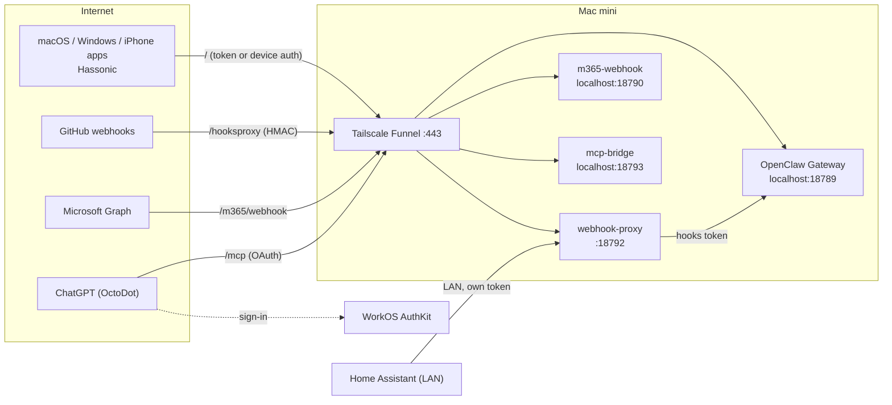

# 🌐 External Integrations

Everything outside the house that talks to Octo, and how it gets in. Octo runs on a Mac mini at home; this page
covers the one public entry point to it and how each kind of traffic is authenticated.

The [guarded Orca–Claw handoff](harness/robots#guarded-handoff) carries read-only handoffs to Claw and only status updates or questions to Orca.

| Integration | What it is |
|---|---|
| [Octo MCP: Octo for other agents](mcp) | Other agents (today OctoDot, an OpenAI Dot in ChatGPT) using Octo through its MCP server, behind WorkOS sign-in |
| [Connected Apps](connected-apps) | Apps that talk to Octo directly: Hassonic and OctoDot |
| [Hooks](hooks) | Webhooks from GitHub and Home Assistant that start agents. Microsoft 365 notifications go to the separate m365-webhook service instead. |

The rest of this page covers the front door they all share. Not every client can join the tailnet (the private
Tailscale network): OpenClaw's macOS, Windows and iPhone apps, Hassonic, and the cloud services all connect from the
public internet. So everything public goes through **Tailscale Funnel** on one hostname (`<funnel-host>` below) and
**port 443**.

## Funnel routes

Everything below shares `https://<funnel-host>`. Tailscale strips the mount prefix before forwarding unless the target
names a path (the MCP routes do, so they arrive unchanged).

| Path | Goes to | Auth |
|---|---|---|
| `/` | OpenClaw Gateway (Control UI, WebSocket) | OpenClaw shared token or paired-device token |
| `/hooks` | Nothing: Funnel answers `not found` | The Gateway's hooks endpoint is never public |
| `/hooksproxy/<route>` | [webhook-proxy](services/webhook-proxy) | Per route: GitHub HMAC signature, or a per-sender token in the `Authorization` header |
| `/m365/webhook` | Direct to [m365-webhook](https://github.com/JeffSteinbok/carapace-m365/tree/main/services/m365-webhook) (Microsoft Graph change notifications) | Graph `clientState` on change notifications |
| `/mcp`, `/.well-known/oauth-protected-resource`, `/.well-known/oauth-authorization-server` | [mcp-bridge](services/mcp-bridge) | WorkOS AuthKit OAuth (see [Octo MCP](mcp)) |

Only port 443 is used. ChatGPT never connects to Funnel's other ports (8443, 10000), which is why the MCP server shares
443 with the Gateway instead of having its own port.

## Who holds which credential

| Credential | Held by | Used for |
|---|---|---|
| OpenClaw hooks token | Gateway (`~/.openclaw/.env` and `~/.openclaw/service-env/ai.openclaw.gateway.env`) and webhook-proxy (its own env file) | The proxy authenticating to the Gateway's `/hooks` |
| GitHub webhook secret | GitHub and webhook-proxy | HMAC-SHA256 signature on every delivery |
| Home Assistant proxy token | Home Assistant `secrets.yaml` and webhook-proxy | Token on the `/hass` route |
| Microsoft Graph `clientState` | Graph subscription and m365-webhook | Validating change notifications |
| OpenClaw shared Gateway token | Gateway, local services that run the `openclaw` CLI | Bootstrap auth; native clients move to paired-device tokens |
| WorkOS access tokens | ChatGPT (short-lived) | Calling `/mcp`; the bridge only checks their signatures |
| mcp-bridge device token | mcp-bridge (`~/.openclaw/secrets/mcp-bridge`, mode 600) | Its own paired-device access to the Gateway (`operator.read` + `operator.write`, no admin) |

No external sender holds the real hooks token. Every OpenClaw CLI process loads `~/.openclaw/.env`
([OpenClaw environment docs](https://docs.openclaw.ai/help/environment)), so local services that run the CLI can still
read it. Everything runs as one macOS user, so separate env files limit accidental exposure; they can't stop a
same-user process from reading a file.

## Hooks hardening

- Webhooks enter only through webhook-proxy (or the dedicated M365 service); `/hooks` is blocked at Funnel.
- The proxy matches routes by exact path, accepts only `POST`, caps bodies at 1 MiB, and locks a client out for 5
  minutes after 10 failed auth attempts in a minute.
- The GitHub route drops pings, unknown senders and non-actionable labels before anything reaches the Gateway.
- `hooks.allowedAgentIds` lists only the agents hooks may run; `main` can never be started by a hook.
- Home Assistant posts to the proxy on the LAN with its own token, not to the Gateway.

## Microsoft 365 accounts

Octo runs one [m365-webhook service](https://github.com/JeffSteinbok/carapace-m365/tree/main/services/m365-webhook)
for Microsoft Graph notifications and token brokering. Each account has separate
OAuth and subscription state, mail rules, logs, a broker credential, and its own
Graph `clientState`. The service answers Graph's subscription validation
handshake, routes notifications by `subscriptionId`, and checks the matching
account's `clientState` before handing off any mail.
The webhook service uses each account's `allowedAgents` list to limit where
it can dispatch mail handoffs.

OpenClaw's Microsoft 365 plugin selects account settings through the account
map's `accounts.<account>.agents` list, with a default account for tools
without an explicit mapping.
The service and plugin policies apply separately. The default account retains
its legacy broker endpoint for existing callers.

### Pending plugin upgrade

As of November 26, 2026 (Pacific), Octo's OpenClaw plugin is on 1.4.1.
The multi-account broker deployment is separate from the pending plugin
upgrade to 1.5.x. Before upgrading, review the following settings for the
default account and each mapped account.

- Set `allowCalendarDeletion: true` only for accounts that require event
  deletion or cancellation. Those actions still require direct consent.
- For accounts that save attachments locally, set `attachmentSaveDirectory`
  to a distinct, existing private absolute directory on a filesystem that
  supports hard links. On Unix, use mode `0700`.

See the [Carapace Microsoft 365 setup guide](https://github.com/JeffSteinbok/carapace-m365#calendar-deletion-and-attachment-storage).

## Changing Funnel

Funnel changes need the Tailscale operator account, so the owner runs them by hand, as scripts with built-in checks
and automatic rollback in `config/tailscale/`:

| File | Purpose |
|---|---|
| `funnel.json` | The intended Funnel configuration |
| `restore-funnel.sh` | Rebuilds every route after a `tailscale funnel reset` |
| `apply-step-*.sh` | One script per change: preflight, apply, verify publicly, run the smoke test, roll back on failure |

## Inbound audio

The Gateway transcribes inbound audio with the Azure Speech CLI. The media
model points to the executable by absolute path so it can find it independently
of the Gateway's command search path.

## Home Assistant camera alerts

The `hass-hooks` agent uses the title and summary from Home Assistant's LLM
Vision automations to describe camera events. Alerts attach the event's saved
frame when available and a current camera collage from managed media. For a
doorbell event with no description, the agent can describe the image and
identifies that fallback in its message. The operator controls detection
context in the Home Assistant automations.

## Verifying changes

Every Funnel change is checked two ways:

- `scripts/smoke-remote-access.sh` sends only requests designed to be rejected or dropped (unsigned webhooks, wrong
  tokens, unauthenticated MCP) and checks Funnel routes, services and the security audit.
- `scripts/healthcheck.py` snapshots the whole system before the change and reports anything that changed but wasn't
  declared. See [Health Check](healthcheck).

## Alternatives considered

| Option | Why not (for now) |
|---|---|
| Tailscale Serve, tailnet only | OpenClaw's recommended default, but every device must join the tailnet |
| OpenClaw-managed Funnel with a password | No stronger than the token, and it needs the whole 443 root |
| Cloudflare Tunnel + Access | Real edge SSO, but the Windows app can't send Access headers yet, and the domain would have to move to Cloudflare |
| `openclaw mcp serve` for OctoDot | stdio only, conversation tools only |
| Building our own OAuth server | Easy to get subtly wrong; WorkOS AuthKit is free at this scale |

## Calendars

Main and Family use the `m365` plugin's `outlook_query_events` for date-specific
availability on the personal and family calendars. It uses inclusive Pacific
dates and pages through Microsoft Graph results. The `outlook-work-calendar`
plugin reads the published work calendar with future coverage through 27 days
after today. The partner's published calendar and TripIt are read through ICS.
Each plugin's sender access rules apply to live tool calls.

### Scheduled snapshots

Both cache jobs run at midnight and hourly from 7 a.m. through 5 p.m. Pacific.
They run as commands on main's schedule.

| Job | Sources and destination |
|---|---|
| `calendar-fetch` | Refreshes main's workspace snapshots for the work calendar (28 days), personal and family Outlook calendars (7 days), and the two ICS feeds (30 days). A failed source keeps its last good snapshot while the remaining sources still run. |
| `partner-calendar-fetch` | Uses the partner account's broker token with read-only calendar scope to fetch a seven-day window for the partner's personal and shared family Outlook calendars. Both results are checked before the job writes them to the partner's workspace. Private events and events with missing or unrecognized sensitivity are represented only as busy intervals. |

Each job sends an iMessage alert to the operator on its first consecutive
failure. The partner job reports a generic error without calendar or account
details. Main's evening briefing checks calendar freshness and coverage before
using the snapshots. See [Decision Models](decision-models).
