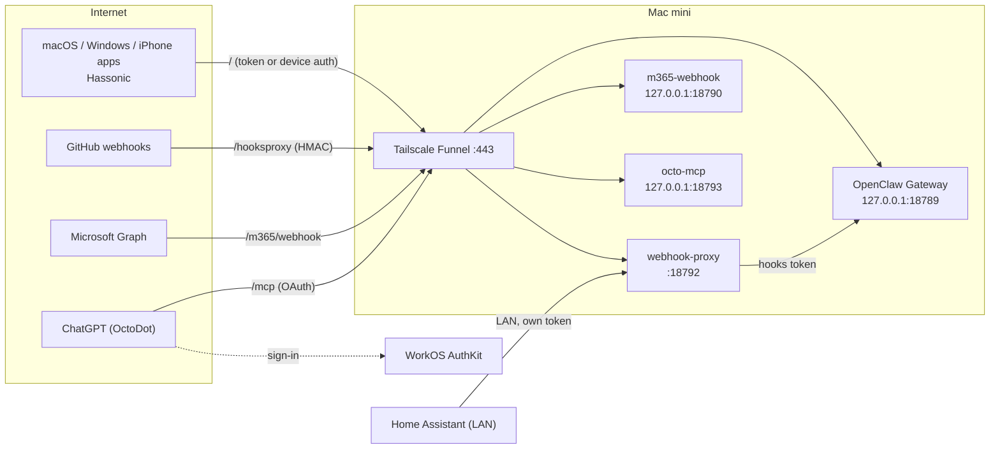

# 🌐 External Integrations

Everything outside the house that talks to Octo, and how it gets in:

| Integration | What it is |
|---|---|
| [MCP & OctoDot](mcp) | OctoDot, an OpenAI Dot in ChatGPT, calling Octo's own MCP server behind WorkOS sign-in |
| [Connected Apps](connected-apps) | Apps that talk to Octo directly: Hassonic and OctoDot |
| [Hooks](hooks) | Webhooks from GitHub, Home Assistant and Microsoft 365 that start agents |

The rest of this page covers the front door they all share. The native apps (macOS, Windows, iPhone, Hassonic) can't
join the tailnet, so everything public goes through **Tailscale Funnel** on one hostname (`<funnel-host>` below) and
**port 443**.

## Funnel routes

Everything below shares `https://<funnel-host>`. Tailscale strips the mount prefix before forwarding unless the target
names a path (the MCP routes do, so they arrive unchanged).

| Path | Goes to | Auth |
|---|---|---|
| `/` | OpenClaw Gateway (Control UI, WebSocket) | OpenClaw shared token or paired-device token |
| `/hooks` | Nothing: Funnel answers `not found` | The Gateway's hooks endpoint is never public |
| `/hooksproxy/<route>` | [webhook-proxy](services/webhook-proxy) | Per route: GitHub HMAC signature, or a per-sender token in the `Authorization` header |
| `/m365/webhook` | m365-webhook (Microsoft Graph change notifications) | Graph `clientState` |
| `/mcp`, `/.well-known/oauth-protected-resource`, `/.well-known/oauth-authorization-server` | [octo-mcp](services/octo-mcp) | WorkOS AuthKit OAuth (see [MCP & OctoDot](mcp)) |

Only port 443 is used. ChatGPT never connects to Funnel's other ports (8443, 10000), which is why the MCP server shares
443 with the Gateway instead of having its own port.

## Who holds which credential

| Credential | Held by | Used for |
|---|---|---|
| OpenClaw hooks token | Gateway (`~/.openclaw/.env`) and webhook-proxy (its own env file) | The proxy authenticating to the Gateway's `/hooks` |
| GitHub webhook secret | GitHub and webhook-proxy | HMAC-SHA256 signature on every delivery |
| Home Assistant proxy token | Home Assistant `secrets.yaml` and webhook-proxy | Token on the `/hass` route |
| Microsoft Graph `clientState` | Graph subscription and m365-webhook | Validating change notifications |
| OpenClaw shared Gateway token | Gateway, local services that run the `openclaw` CLI | Bootstrap auth; native clients move to paired-device tokens |
| WorkOS access tokens | ChatGPT (short-lived) | Calling `/mcp`; octo-mcp only checks their signatures |
| octo-mcp device token | octo-mcp (`~/.openclaw/secrets/octo-mcp`, mode 600) | Its own paired-device access to the Gateway (`operator.read` + `operator.write`, no admin) |

No external sender holds the real hooks token. Every OpenClaw CLI process loads `~/.openclaw/.env`
([OpenClaw environment docs](https://docs.openclaw.ai/help/environment)), so local services that run the CLI can still
read it. Everything runs as one macOS user, so separate env files limit accidental exposure; they can't stop a
same-user process from reading a file.

## Hooks hardening

- Webhooks enter only through webhook-proxy (or the dedicated M365 service); `/hooks` is blocked at Funnel.
- The proxy matches routes by exact path, accepts only `POST`, caps bodies at 1 MiB, and locks out a client after 10
  failed auth attempts in a minute (5 minutes).
- The GitHub route drops pings, unknown senders and non-actionable labels before anything reaches the Gateway.
- `hooks.allowedAgentIds` lists only the agents hooks may run; `main` can never be started by a hook.
- Home Assistant posts to the proxy on the LAN with its own token, not to the Gateway.

## Changing Funnel

Funnel changes need the Tailscale operator account, so they are owner-run scripts with built-in checks and automatic
rollback, in `config/tailscale/`:

| File | Purpose |
|---|---|
| `funnel.json` | The intended Funnel configuration |
| `restore-funnel.sh` | Rebuilds every route after a `tailscale funnel reset` |
| `apply-step-*.sh` | One script per change: preflight, apply, verify publicly, run the smoke test, roll back on failure |

## Verifying changes

Every step is checked twice:

- `scripts/smoke-remote-access.sh` sends only requests designed to be rejected or dropped (unsigned webhooks, wrong
  tokens, unauthenticated MCP) and checks Funnel routes, services and the security audit.
- `scripts/healthcheck.py` snapshots the whole system before a step and reports anything that changed but wasn't
  declared. See [Health Check](healthcheck).

## Alternatives considered

| Option | Why not (for now) |
|---|---|
| Tailscale Serve, tailnet only | OpenClaw's recommended default, but every device must join the tailnet |
| OpenClaw-managed Funnel with a password | No stronger than the token, and it needs the whole 443 root |
| Cloudflare Tunnel + Access | Real edge SSO, but the Windows app can't send Access headers yet, and the domain would have to move to Cloudflare |
| `openclaw mcp serve` for OctoDot | stdio only, conversation tools only |
| Building our own OAuth server | Easy to get subtly wrong; WorkOS AuthKit is free at this scale |

## Still to do

- Re-pair the native clients with setup codes (no admin scope), prune old pairings, then rotate the shared Gateway
  token and bind the Gateway to loopback.
- Remove the old Control UI pairings OctoDot used before MCP.
