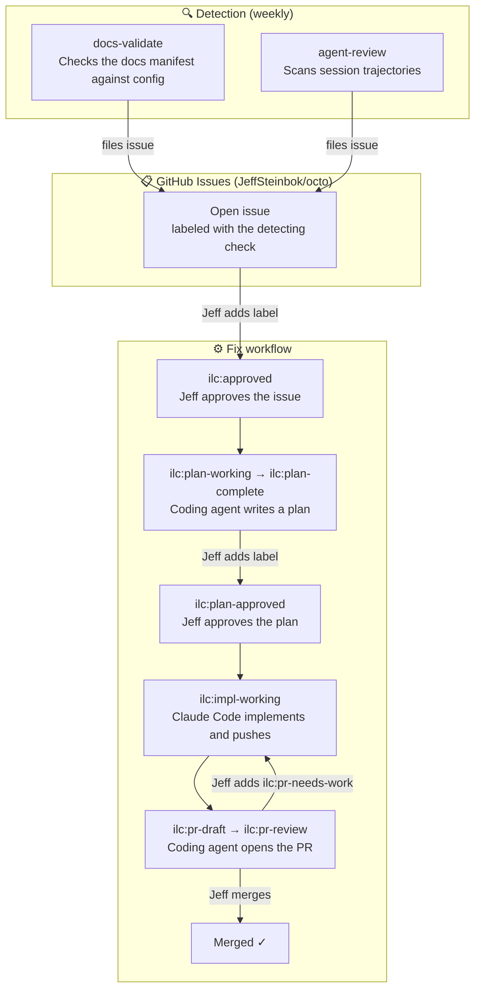

# 🔧 Engineering Harness

The Engineering Harness is how Octo finds and fixes its own problems. Scheduled checks look for drift and quality issues and file them as GitHub issues in `JeffSteinbok/octo`. A label-driven workflow then takes each approved issue through a written plan, an automated fix, and a pull request that Jeff (the owner) reviews and merges. GitHub Issues is the single record of what was found and what happened to it.

The harness has three parts:

- **Detection** — weekly jobs that file issues ([below](#detection))
- **Fix workflow** — the [Issue Lifecycle](harness/issue-lifecycle) state machine that turns an approved issue into a PR
- **[Health Check](healthcheck)** — a before-and-after regression check for changes to the running system



> ⚠️ **Nothing merges without Jeff's approval.**
> Octo writes plans and code, but three manual gates are always required:
> 1. Jeff adds `ilc:approved` before any planning starts
> 2. Jeff adds `ilc:plan-approved` before any code is written
> 3. Jeff clicks **Merge** on the PR — no auto-merge is configured

---

## Detection

Two checks run as weekly scheduled jobs under the `root` agent and file GitHub issues for what they find. Each one skips findings that already have an open issue with its label, so the same problem is not filed twice.

### Docs validation

| | |
|---|---|
| **Script** | `tools/docs/scripts/validate_docs.py` |
| **Schedule** | Mondays, 6 AM Pacific |
| **Issue label** | `docs-validate` |

Checks that `config/doc-manifest.json` (the list of what the public docs cover; see [About These Docs](about-docs)) agrees with the live `openclaw.json` config, the exported cron jobs, the `services/` directory and, optionally, the rendered site:

| Severity | Check |
|----------|-------|
| ERROR | Schema — unknown keys, missing required fields, invalid `docsMode` |
| ERROR | Manifest ↔ config — every plugin in the manifest must exist in `openclaw.json` |
| WARN | Public but disabled — a `public: true` plugin is `enabled: false` in config |
| WARN | Enabled but undocumented — an enabled plugin (other than a model provider) is missing from the manifest |
| WARN / INFO | Retired jobs — a manifest job is not in `config/cron_jobs_export.json` (WARN if the job is public) |
| WARN / INFO | Undocumented jobs — an enabled job is missing from the manifest (WARN for `root` or system jobs, and for jobs whose names look like infrastructure) |
| WARN | Services — no local README and not `docsMode: external`; README directory missing from the manifest; local service with no page spec |
| WARN | Rendered site — empty tables, `Unknown` schedule cells, relative links that don't resolve to a rendered page |

ERROR and WARN findings are filed as issues. INFO findings are printed but never filed.

```bash
cd ~/git/octo
python3 tools/docs/scripts/validate_docs.py --render     # build the docs, audit the site, file issues (the weekly job)
python3 tools/docs/scripts/validate_docs.py --dry-run    # preview only
python3 tools/docs/scripts/validate_docs.py --no-issues --rendered out/docs-site  # check an existing build, file nothing
```

### Agent review

| | |
|---|---|
| **Skill** | `agents/root/skills/agent-review/` (a wrapper; the shared implementation is in [openclaw-hub](https://github.com/JeffSteinbok/openclaw-hub/tree/main/skills/agent-review)) |
| **Script** | `openclaw-hub/skills/agent-review/scripts/agent_review.py` |
| **Schedule** | Sundays, 9 PM Pacific |
| **Issue label** | `agent-review` |

Scans the past week of session trajectories (the recorded tool calls and results of each agent run) and memory files for recurring tool failures, cron errors, user corrections and capability gaps. It files an issue for each significant finding and posts a short summary to #octo-status. An hour later, `agent-review-labels` (`scripts/agent_review_gate.py`) asks the decision model what kind each new issue is and whether it duplicates an existing one; that check is log-only (see [Decision Models](decision-models)).

---

## Fix workflow

Issues in `JeffSteinbok/octo` move through a label-driven state machine run by Octo's `coding` agent. A GitHub webhook wakes the agent when Jeff adds one of the three trigger labels to an issue, and the label says what to do next. Jeff starts each issue by adding `ilc:approved`, approves the plan with `ilc:plan-approved`, and merges the PR; the coding agent and Claude Code do the rest.

See **[Issue Lifecycle](harness/issue-lifecycle)** for the full state machine, every label, and what happens at each step.
