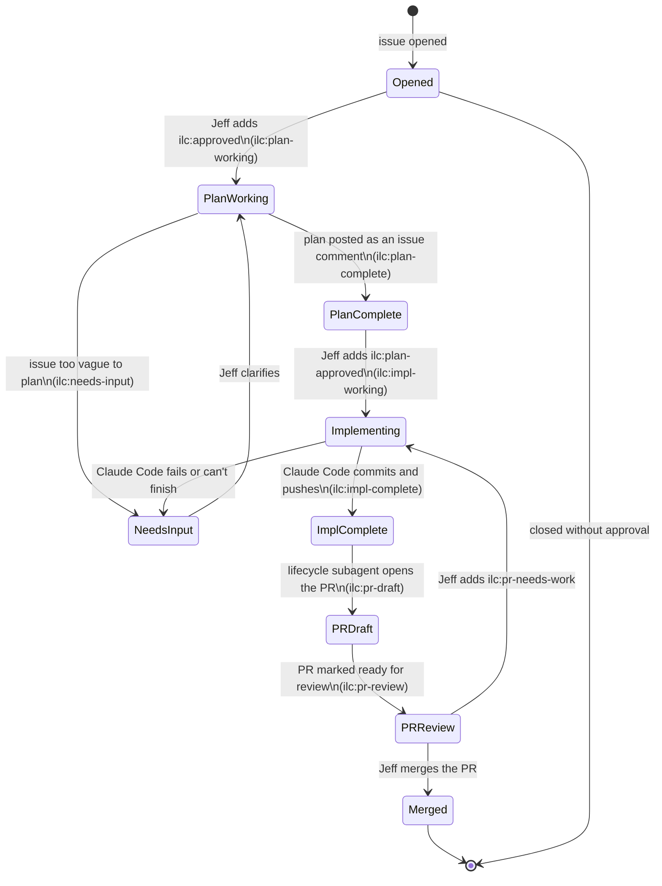

# Issue Lifecycle

The issue lifecycle is the fix workflow of the [Engineering Harness](../harness). It takes an issue in `JeffSteinbok/octo` from Jeff's approval through a written plan, an implementation, and a pull request, using GitHub labels to record where each issue is. Octo's `coding` agent runs the workflow; Claude Code writes the code; Jeff approves each stage and merges.

> ⚠️ **Nothing merges without Jeff's approval.**
> Three manual gates are always required:
> 1. Jeff adds `ilc:approved` to start planning
> 2. Jeff adds `ilc:plan-approved` to start implementation
> 3. Jeff clicks **Merge** on the PR — there is no auto-merge

## How it is triggered

A GitHub webhook sends issue events to Octo's Gateway. The `github-issues` hook forwards an event to the `coding` agent only when an allowlisted GitHub account (Jeff's, or one other) adds one of three trigger labels to an issue: `ilc:approved`, `ilc:plan-approved` or `ilc:pr-needs-work`. (The older `ilc:plan-pending` label is still accepted.) Every other event is dropped, so opening an issue does nothing on its own.

The coding agent does not do the work in its own session. For each event it starts a **lifecycle subagent**, which handles that issue from then on and reports progress in a Discord thread for the issue (`#N — <short title>`) in the `#coding` channel. The hook's final reply goes to Jeff over iMessage.

## State machine

## Labels

Every lifecycle label starts with `ilc:` (**i**ssue **l**ife**c**ycle), so the labels group together and don't collide with other labels. An issue has only one lifecycle label at a time: the subagent always removes the current label before adding the next.

**Plan phase**

| Label | Set by | Meaning |
|---|---|---|
| `ilc:approved` | Jeff | Start planning |
| `ilc:plan-working` | Octo | Writing the plan |
| `ilc:plan-complete` | Octo | Plan posted on the issue, waiting for Jeff's review |
| `ilc:needs-input` | Octo or Jeff | Blocked, waiting for information or a decision |
| `ilc:plan-approved` | Jeff | Plan approved, start implementation |

**Implementation phase**

| Label | Set by | Meaning |
|---|---|---|
| `ilc:impl-working` | Octo | Claude Code is writing, testing and committing the code |
| `ilc:impl-complete` | Octo | Code pushed to the branch, PR not open yet |

**PR phase**

| Label | Set by | Meaning |
|---|---|---|
| `ilc:pr-draft` | Octo | PR opened, not yet marked ready |
| `ilc:pr-review` | Octo | PR ready for Jeff's review and merge |
| `ilc:pr-needs-work` | Jeff | PR has review comments, go back to implementation |

## Who does what during implementation

The work is split in two:

- **Lifecycle subagent (the orchestrator)** owns everything around the code: label changes, posts to the issue's Discord thread, issue comments, and opening and updating the PR. It never writes code itself.
- **Claude Code** runs through ACP (the Agent Client Protocol, which lets OpenClaw start an external coding agent) with `sessions_spawn({ runtime: "acp", agentId: "claude" })`. It works in a separate git worktree on a `fix/N-short-description` branch, writes the code, runs the tests, commits, and pushes. It doesn't touch labels, the Discord thread or the PR.

If Claude Code can't be started, fails, or reports that it couldn't finish, the subagent does not fall back to writing the code. It sets `ilc:needs-input` and posts the error to the thread.

The exact handoff is in `agents/coding/skills/issue-lifecycle/SKILL.md`, under "Code Work — Claude Code via ACP".

## What happens at each step

### Jeff adds `ilc:approved`

1. Finds or creates the issue's Discord thread and posts that work has started
2. Replaces `ilc:approved` with `ilc:plan-working`
3. Reads the issue and posts a plan as an issue comment: what changes, which files, the approach, and any risks or open questions (if the issue is too vague to plan, sets `ilc:needs-input` instead)
4. Replaces `ilc:plan-working` with `ilc:plan-complete`
5. Asks Jeff in the thread to review the plan

### Jeff adds `ilc:plan-approved`

1. Removes `ilc:plan-approved` and `ilc:plan-complete` and adds `ilc:impl-working` (first, so the same event can't start the work twice)
2. Posts to the thread that implementation has started
3. Starts Claude Code for each affected repo; it branches from the latest `main`, implements the plan, tests, commits and pushes
4. Replaces `ilc:impl-working` with `ilc:impl-complete`
5. Opens a PR from the pushed branch (the PR body includes `Closes JeffSteinbok/octo#N`) and replaces `ilc:impl-complete` with `ilc:pr-draft`
6. When the PR is ready for review, replaces `ilc:pr-draft` with `ilc:pr-review` and posts the PR link to the thread

### Jeff adds `ilc:pr-needs-work`

1. Replaces `ilc:pr-needs-work` with `ilc:impl-working`
2. Reads the PR review comments
3. Starts Claude Code with those comments; it fixes, tests, commits and pushes to the existing PR branch
4. Moves the issue through `ilc:impl-complete` back to `ilc:pr-review` and tells Jeff in the thread that the PR is ready for another review
