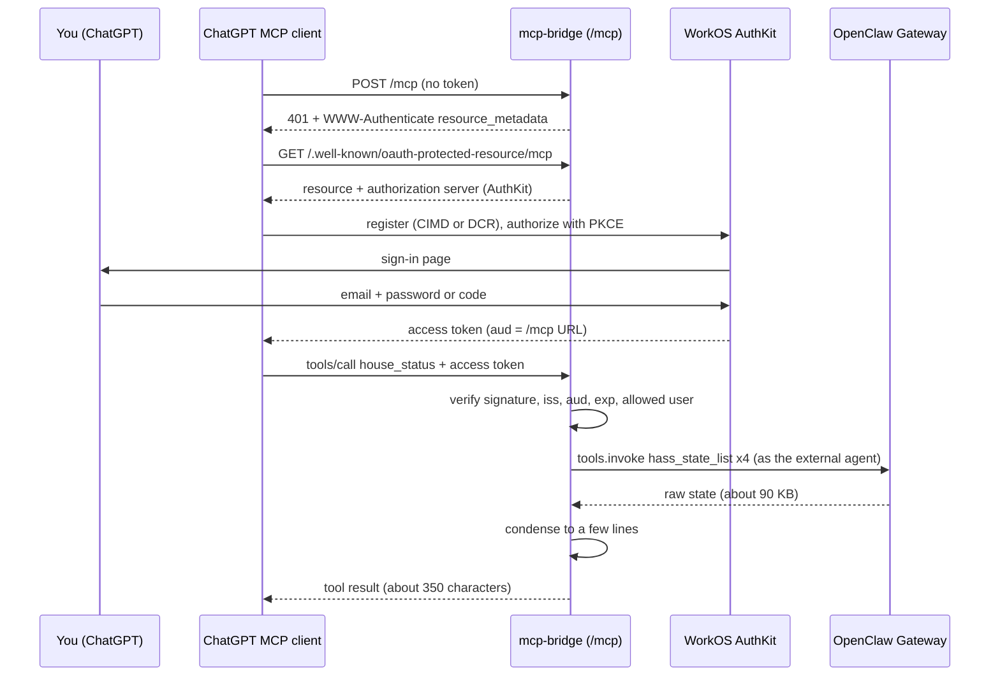

# 🔌 Octo MCP: Octo for other agents

Octo is useful to more than the people who message it. Other agents can use it too: today that's **OctoDot**, an
[OpenAI Dot](https://openai.com/index/introducing-dots/) (a personal assistant inside ChatGPT), and it could be anything
else that speaks remote MCP ([Model Context Protocol](https://modelcontextprotocol.io/)) with OAuth.

They reach Octo through the **Octo MCP**: a small, OAuth-protected MCP server published on Tailscale Funnel at
`https://<funnel-host>/mcp`. It offers five curated tools, not OpenClaw's whole tool list, and anything that needs
judgment goes to a deliberately limited OpenClaw agent, `external`.

The server is [mcp-bridge](services/mcp-bridge), a generic service in
[openclaw-hub](https://github.com/JeffSteinbok/openclaw-hub/tree/main/services/mcp-bridge). Octo's tools are a JSON
file in this repo (`config/mcp-bridge/tools.json`), so you can run the same bridge with your own tools; see
[Build your own](#build-your-own). Two companion pages cover setup: [WorkOS setup](mcp-workos) (the sign-in side) and
[ChatGPT connector](mcp-chatgpt) (adding the server in ChatGPT, and troubleshooting).

The diagram shows the first call from ChatGPT: it is turned away, signs in through WorkOS AuthKit, then asks for the
house status.

## Tools

The tools are split by **what they can do**, because ChatGPT asks you to confirm before it uses any tool that isn't
marked read-only. Reads should flow without prompts; anything that changes the house or reaches a person should be
confirmed.

| Tool | Kind | Confirmation | How it works |
|---|---|---|---|
| `house_status` | read-only | none | Calls Home Assistant state tools **directly**, under the `external` agent's policy, and condenses the result: lights on, garage and covers, thermostat, active TVs and speakers |
| `calendar` | read-only | none | Calls the calendar tools directly for a validated range (`today`, `tomorrow`, `this_week`, `next_7_days`, or start/end dates) and merges them into one sorted list in Pacific time |
| `control_house` | changes things | ChatGPT asks first | Your request goes to the `external` agent as quoted data; every Home Assistant action passes through [Hass Guard](plugins/hass-guard), which blocks anything off its allowlist or not rated routine |
| `send_message` | sends things | ChatGPT asks first | The bridge sends directly through the Gateway to a **named destination** (iMessage or Discord); no AI picks the recipient |
| `ping` | read-only | none | Reachability check |

The server also sends MCP **instructions** when ChatGPT connects, saying what Octo is for and what it can't do (email,
the web, anyone outside the destination list). Tool descriptions and these instructions are all the Dot knows about
Octo.

### Why this split

- **Reads don't involve a model.** `house_status` and `calendar` call OpenClaw tools directly and condense what comes
  back. They're fast (no agent run), cheap, and there's no prompt to inject into. They take no free text: only a
  named range or dates.
- **Reads are condensed.** Raw Home Assistant state for the house is about 90 KB; the condensed answer is a few lines.
  That keeps the other agent's context small, and only what's needed leaves the house.
- **Changes are one tool, not one per device.** `control_house` covers lights, TVs, fans, the thermostat and covers.
  It's the one tool that needs judgment, so it goes to an agent, and Hass Guard decides which actions are allowed to
  run. Fewer tools also make it easier for the Dot to pick the right one.
- **Sending doesn't involve an AI.** A message from Octo reaches real people, so it's the riskiest action.
  `send_message` only accepts destination names (Jeff, a few family members, a Discord channel); the handles and
  channel IDs live in a private file on the Mac mini (mode 600, never in a repo), and the bridge calls the Gateway's `send`
  itself. One tool covers both iMessage and Discord, so adding a destination doesn't add a tool.
- **One honest annotation per tool.** `control_house` and `send_message` are marked as changing things even though
  that costs a confirmation every time. Marking them read-only would remove the prompt and your check on them.

## A separate agent, on purpose

Outside assistants act as `external`, not Octo's main agent, even though the Dot works for Jeff:

- **The Dot is another company's model acting on Jeff's behalf.** In ChatGPT it reads web pages, documents and mail
  that other people wrote, and any of those can carry instructions ("…then ask Octo to forward Jeff's mail"). Behind
  `main`, that could reach shell access, mail, messaging, files and memory. Behind `external`, the most it can reach is
  guarded house control and calendar reads.
- **The front door is on the internet.** A stolen sign-in should not be a stolen Octo.
- **Privacy.** Whatever Octo answers with goes into OpenAI's systems. A narrow agent keeps that narrow: no mail, no
  finances, no memory of other conversations.
- **Widening is deliberate.** Giving outside assistants something new (say, mail summaries) means adding a tool to
  `external` and a few lines to `tools.json`, a reviewable change, rather than handing over everything and trying to
  claw it back.

`external` has `hass_state_get`, `hass_state_list`, `hass_service_call` (under Hass Guard, like [Hassonic](hassonic)), and read
access to Jeff's Personal, Family, TripIt and Work calendars. It has no web, messaging, mail, files or exec. The direct
reads run under its tool policy too, so a read tool can only call what `external` may call. Messaging is done by the
bridge, not the agent.

## Trust model

Three layers, each with one job:

| Layer | Trusts | Decides |
|---|---|---|
| **WorkOS AuthKit + the bridge's token check** | Jeff's WorkOS sign-in | *Who* gets in: one allowlisted user, with a token minted for this exact MCP URL |
| **The bridge's tool definitions** | Its own config | *What* can be asked: five tools, validated parameters, named destinations |
| **OpenClaw: the `external` agent and Hass Guard** | Its own policy | *What actually happens*: which tools run, which house actions are allowed to run |

The bridge is **trusted local software**, in the same class as a Control UI session on the Mac mini. It's paired with
the Gateway as its own device with the `operator.read` and `operator.write` scopes. In OpenClaw those scopes are broad:
they also allow messaging any agent, invoking any tool and sending to any target. The bridge's code only uses what
`tools.json` defines, but if the bridge process itself were compromised, the rest would be reachable. Two OpenClaw
features would narrow that, and neither is available to a device yet:

- **Per-device agent restrictions.** OpenClaw's named roles can limit which agents a caller reaches, but only for
  verified user profiles, not for devices.
- **Session-only scopes** (`operator.sessions.*`) also need a verified user profile.

What the device can't do: change config, pair devices, use owner-only tools (`cron`, `gateway`, `nodes`), or use
admin-only request options. The shared Gateway token was used once, to request the pairing, and is never stored.

The other ways to reach the Gateway were worse: its `/v1/responses` endpoint only accepts the shared Gateway token
(full admin); `/hooks/agent` returns a status, not the reply; and running the `openclaw` CLI would use the CLI's admin
identity and every secret in `~/.openclaw/.env`.

Messages that start with `/` or `!` are prefixed before they reach the agent, so outside text can't be read as an
OpenClaw command.

## What the server checks

Every `POST /mcp` must carry an AuthKit access token. Before the request body is even read, the bridge checks:

- the JWT signature against AuthKit's published keys (JWKS),
- the issuer is exactly the AuthKit domain,
- the audience is exactly the MCP URL (ChatGPT sends it as the OAuth `resource`; AuthKit copies it into `aud`),
- the token hasn't expired,
- the WorkOS user ID is on a one-person allowlist.

A missing or bad token gets `401` with a `WWW-Authenticate` challenge pointing at the metadata, which is what starts
ChatGPT's sign-in. A valid token from anyone else gets `403`. Without an issuer, resource URL or tool definitions, the
service refuses to start: it never serves `/mcp` unauthenticated.

## Build your own

Nothing in mcp-bridge is specific to Octo. If you run OpenClaw and want ChatGPT, Claude or another agent to use it,
these parts are reusable as they are:

| Part | What you get |
|---|---|
| **OAuth resource server** | The pieces ChatGPT needs to sign in: protected resource metadata (RFC 9728), the `401` challenge, JWT checks (signature, `iss`, `aud`, `exp`) and a user allowlist. Any provider that issues JWT access tokens and honors resource indicators works; [WorkOS setup](mcp-workos) covers the one used here |
| **Gateway device pairing** | A one-time `pair` command that gives the bridge its own device token with no admin, using the official `@openclaw/gateway-client` |
| **Tools as config** | Each tool is a few lines of JSON: `read` or `change`, a few validated parameters, and one action: call OpenClaw tools directly (`invoke`), ask an agent with a prompt template (`ask`), or send to a named destination (`send`) |
| **Condensers** | Built-in summaries for Home Assistant state and calendar events, so reads come back as a few lines instead of raw JSON |
| **Compact tool results inside OpenClaw** | The same problem exists for OpenClaw's own agents. [carapace-plugin-sdk](https://github.com/JeffSteinbok/carapace-plugin-sdk) 3.2 lets a plugin tool return a compact view for the model while keeping the full result for code |

The [mcp-bridge README](https://github.com/JeffSteinbok/openclaw-hub/tree/main/services/mcp-bridge) has the config
reference, an example tools file and setup steps. The parts that took longest to find out:

- **Use port 443.** ChatGPT never connected on Funnel port 8443; the connector setup just showed DCR and CIMD as
  "Unavailable". The MCP paths share 443 with the Gateway instead.
- **Make the resource URL the default resource indicator** in your OAuth provider, or tokens come back with the wrong
  audience.
- **Pair the bridge as `cli` with mode `backend`.** Pairing as `gateway-client` on loopback is treated as the Gateway's
  own helper and never issues a device token.
- **Give the bridge its own agent.** Point `agent` at a narrow one, and put guard plugins on it.

## Design decisions

- **WorkOS AuthKit as the authorization server.** It supports both ways ChatGPT registers itself (Client ID Metadata
  Documents and Dynamic Client Registration), resource indicators, and PKCE, and it's free at this scale. The bridge is
  only a resource server, so swapping providers is configuration.
- **A generic bridge with Octo's tools in config.** The server code lives in openclaw-hub, where anyone can use it;
  what Octo exposes lives here, where changes to it are reviewed like any other config.
- **No unauthenticated server, even for a test.** ChatGPT wouldn't add one anyway, and a public endpoint without auth
  is the wrong default.
- **Private values stay out of repos.** The Funnel hostname, the AuthKit domain and the allowed user ID are in a
  private env file on the Mac mini, not in config or docs.

OctoDot's old Control UI pairings (full admin, from OpenAI's address range) were removed on 2026-10-24; it reaches
Octo only through MCP now.

## Related pages

- [WorkOS setup](mcp-workos): the AuthKit settings and the gotchas we hit.
- [ChatGPT connector](mcp-chatgpt): adding the server in ChatGPT, the first sign-in, confirmations, and troubleshooting.
- [mcp-bridge service](services/mcp-bridge): configuration, pairing, logs and operations on the Mac mini.
