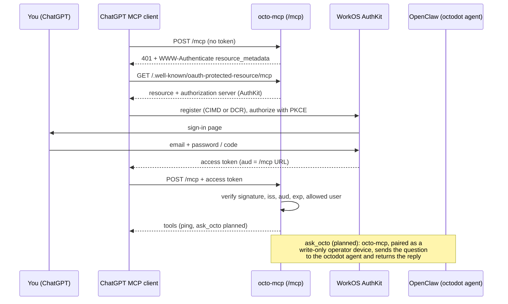

# 🔌 MCP & OctoDot

OctoDot is an [OpenAI Dot](https://openai.com/index/introducing-dots/) in ChatGPT. It reaches Octo through a custom
**MCP connector**: ChatGPT calls Octo's own MCP server, [octo-mcp](services/octo-mcp), which sits behind
**WorkOS AuthKit** OAuth and is published on Tailscale Funnel at `https://<funnel-host>/mcp`.

## Status

| Piece | State |
|---|---|
| octo-mcp on `/mcp` with OAuth | Live |
| WorkOS AuthKit (one invited user, sign-up off) | Live |
| ChatGPT connector, OctoDot calling `ping` | Working |
| `ask_octo` tool → `octodot` agent | Planned |

## What the server checks

Every `POST /mcp` must carry an AuthKit access token. Before the request body is even read, octo-mcp checks:

- the JWT signature against AuthKit's published keys (JWKS),
- the issuer is the AuthKit domain,
- the audience is exactly the MCP URL (ChatGPT sends it as the OAuth `resource`; AuthKit copies it into `aud`),
- the token hasn't expired,
- the WorkOS user ID is on a one-person allowlist.

A missing or bad token gets `401` with a `WWW-Authenticate` challenge pointing at the metadata, which is what starts
ChatGPT's sign-in. A valid token from anyone else gets `403`. Without an AuthKit issuer configured, the service refuses
to start: it never serves `/mcp` unauthenticated. octo-mcp holds no secrets.

## Planned: `ask_octo` and the `octodot` agent

- **`octodot` agent:** a small, dedicated agent like Hassonic's, with Home Assistant read and control
  (`hass_state_get`, `hass_state_list`, `hass_service_call`) and calendar read. No exec, no messaging.
- **How octo-mcp reaches OpenClaw:** paired as its own operator device with only `operator.read` and `operator.write`,
  using OpenClaw's [`@openclaw/gateway-client`](https://docs.openclaw.ai/gateway/clients). It never holds the shared
  Gateway token after pairing, and it can't administer the Gateway.
- **Then:** remove the two old Control UI pairings OctoDot used before, which had full admin access.

## Design decisions

- **WorkOS AuthKit as the authorization server.** It supports both ways ChatGPT registers itself (Client ID Metadata
  Documents and Dynamic Client Registration), resource indicators, and PKCE, and it's free at this scale. octo-mcp is
  only a resource server, so swapping providers later is mostly configuration.
- **Port 443, shared with the Gateway.** ChatGPT never connected to Funnel port 8443: the connector setup showed DCR
  and CIMD as "Unavailable" because metadata discovery never reached the server. The MCP paths are mounted on 443
  instead; the Gateway doesn't use them.
- **No unauthenticated server, even for a test.** ChatGPT wouldn't add one anyway, and a public endpoint without auth
  is the wrong default.

## Pages

- [WorkOS setup](mcp-workos): the AuthKit settings and the gotchas we hit.
- [ChatGPT connector](mcp-chatgpt): adding the server in ChatGPT, the first sign-in, and troubleshooting.
- [octo-mcp service](services/octo-mcp): configuration, logs and operations.
