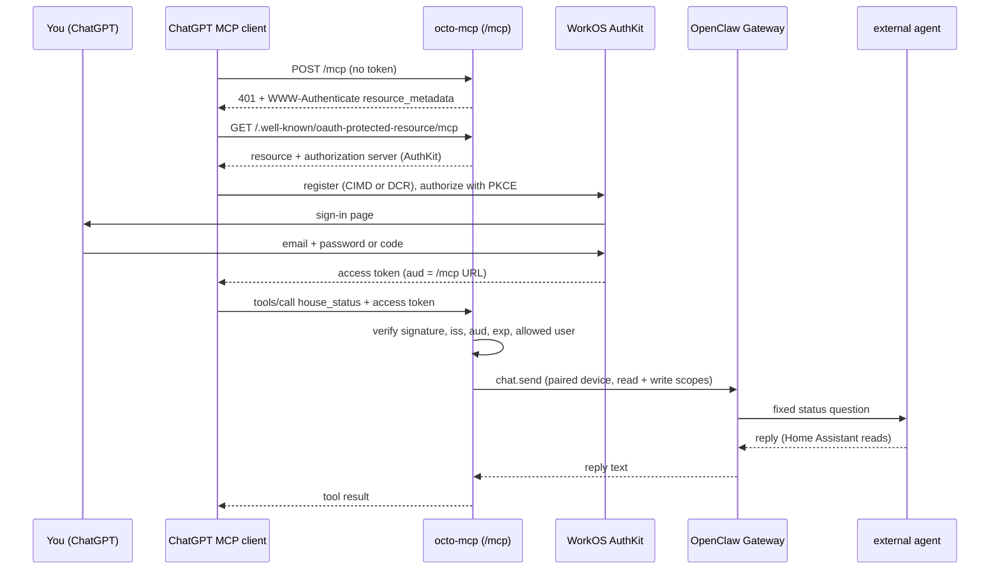

# 🔌 MCP & OctoDot

OctoDot is an [OpenAI Dot](https://openai.com/index/introducing-dots/) in ChatGPT. It reaches Octo through a custom
**MCP connector**: ChatGPT calls Octo's own MCP server, [octo-mcp](services/octo-mcp), which sits behind
**WorkOS AuthKit** OAuth and is published on Tailscale Funnel at `https://<funnel-host>/mcp`. Behind octo-mcp, a
deliberately limited OpenClaw agent, `external`, does the work.

## Tools

The tools are split by **what they can do**, because ChatGPT asks you to confirm before it uses any tool that isn't
marked read-only. Reads should flow without prompts; anything that changes the house or reaches a person should be
confirmed.

| Tool | Kind | Confirmation | How it works |
|---|---|---|---|
| `house_status` | read-only | none | A fixed question to the `external` agent: lights, garage and covers, thermostat, TVs |
| `calendar` | read-only | none | A fixed question with a validated range (`today`, `tomorrow`, `this_week`, `next_7_days`, or start/end dates) |
| `control_house` | changes things | ChatGPT asks first | Your request goes to the `external` agent as quoted data; every Home Assistant action passes through Hass Guard, and unusual ones wait for Jeff's approval |
| `send_message` | sends things | ChatGPT asks first | octo-mcp sends directly through the Gateway to a **named destination** (iMessage or Discord); no AI picks the recipient |
| `ping` | read-only | none | Reachability check |

The server also sends MCP **instructions** when ChatGPT connects, saying what Octo is for and what it can't do (email,
the web, anyone outside the destination list). Tool descriptions and these instructions are all the Dot knows about
Octo.

### Why this split

- **Reads carry no free text.** `house_status` takes no input and `calendar` only accepts a named range or dates. The
  agent behind them can also change the house, so a read must not be talkable into a change. With no caller text in
  the prompt, there's nothing to inject.
- **Changes are one tool, not one per device.** `control_house` covers lights, TVs, fans, the thermostat and covers.
  Hass Guard, not the tool list, decides which actions are allowed and which need approval. Fewer tools also makes it
  easier for the Dot to pick the right one.
- **Sending doesn't involve an AI.** A message from Octo reaches real people, so it's the riskiest action.
  `send_message` only accepts destination names (`jeff`, `nicole`, `aaron`, `walter`, `jeff_discord`,
  `discord_general`); the handles and channel IDs live in a private file on the Mac (mode 600, never in a repo), and
  octo-mcp calls the Gateway's `send` itself. One tool covers both iMessage and Discord, so adding a destination
  doesn't add a tool.
- **One honest annotation per tool.** `control_house` and `send_message` are marked as changing things even though
  that costs a confirmation every time. Marking them read-only would remove the prompt and your check on them.

## A separate agent, on purpose

Outside assistants talk to `external`, not to Octo's main agent, even though the Dot works for Jeff:

- **The Dot is another company's model acting on Jeff's behalf.** In ChatGPT it reads web pages, documents and mail
  that other people wrote, and any of those can carry instructions ("…then ask Octo to forward Jeff's mail"). Behind
  `main`, that could reach shell access, mail, messaging, files and memory. Behind `external`, the most it can reach is
  guarded house control and calendar reads.
- **The front door is on the internet.** A stolen sign-in should not be a stolen Octo.
- **Privacy.** Whatever the agent answers with goes into OpenAI's systems. A narrow agent keeps that narrow: no mail,
  no finances, no memory of other conversations.
- **Widening is deliberate.** Giving outside assistants something new (say, mail summaries) means adding one tool to
  `external`, a reviewable change, rather than handing over everything and trying to claw it back.

`external` has `hass_state_get`, `hass_state_list`, `hass_service_call` (under Hass Guard, like Hassonic), and read
access to Jeff's Personal, Family, TripIt and Work calendars. It has no web, messaging, mail, files or exec. Messaging
is done by octo-mcp directly, not by the agent.

## How octo-mcp reaches OpenClaw

octo-mcp is **paired with the Gateway as its own device** (display name `octo-mcp`) using OpenClaw's official
[`@openclaw/gateway-client`](https://docs.openclaw.ai/gateway/clients), with the `operator.read` and `operator.write`
scopes. The shared Gateway token is used once, to request the pairing, and never stored; afterwards octo-mcp signs in
with its own device token.

What that access does and doesn't allow:

- **Can't:** change config, pair devices, or use owner-only tools (`cron`, `gateway`, `nodes`), and it can't use
  admin-only request options.
- **Can, in principle:** `operator.write` also allows invoking tools that an agent's policy permits and sending to any
  target. octo-mcp's own code only ever sends questions to `external` and messages to its destination list, and all of
  it sits behind WorkOS sign-in, so this matters only if octo-mcp itself were compromised.
- **Why not narrower:** OpenClaw's session-only scopes (`operator.sessions.*`) need a verified user profile, which a
  paired device doesn't have. Worth revisiting if OpenClaw user profiles are set up.
- **Why not the alternatives:** `/v1/responses` only accepts the shared Gateway token (full admin); `/hooks/agent`
  returns a status, not the reply; running the `openclaw` CLI would use its admin identity and every secret in `.env`.

Messages that start with `/` or `!` are prefixed before they reach the agent, so outside text can't be read as an
OpenClaw command.

## What the server checks

Every `POST /mcp` must carry an AuthKit access token. Before the request body is even read, octo-mcp checks:

- the JWT signature against AuthKit's published keys (JWKS),
- the issuer is the AuthKit domain,
- the audience is exactly the MCP URL (ChatGPT sends it as the OAuth `resource`; AuthKit copies it into `aud`),
- the token hasn't expired,
- the WorkOS user ID is on a one-person allowlist.

A missing or bad token gets `401` with a `WWW-Authenticate` challenge pointing at the metadata, which is what starts
ChatGPT's sign-in. A valid token from anyone else gets `403`. Without an AuthKit issuer configured, the service refuses
to start: it never serves `/mcp` unauthenticated.

## Design decisions

- **WorkOS AuthKit as the authorization server.** It supports both ways ChatGPT registers itself (Client ID Metadata
  Documents and Dynamic Client Registration), resource indicators, and PKCE, and it's free at this scale. octo-mcp is
  only a resource server, so swapping providers later is mostly configuration.
- **Port 443, shared with the Gateway.** ChatGPT never connected to Funnel port 8443: the connector setup showed DCR
  and CIMD as "Unavailable" because metadata discovery never reached the server. The MCP paths are mounted on 443
  instead; the Gateway doesn't use them.
- **No unauthenticated server, even for a test.** ChatGPT wouldn't add one anyway, and a public endpoint without auth
  is the wrong default.

OctoDot's old Control UI pairings (full admin, from OpenAI's address range) were removed on 2026-10-24; it reaches
Octo only through MCP now.

## Pages

- [WorkOS setup](mcp-workos): the AuthKit settings and the gotchas we hit.
- [ChatGPT connector](mcp-chatgpt): adding the server in ChatGPT, the first sign-in, confirmations, and troubleshooting.
- [octo-mcp service](services/octo-mcp): configuration, pairing, logs and operations.
